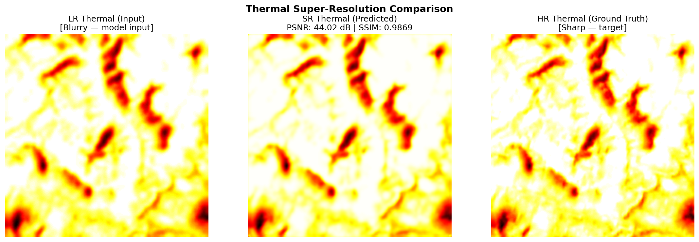
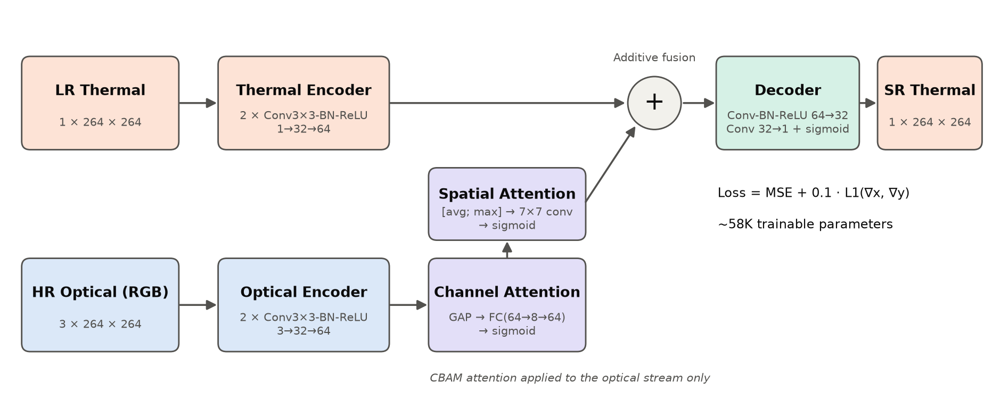
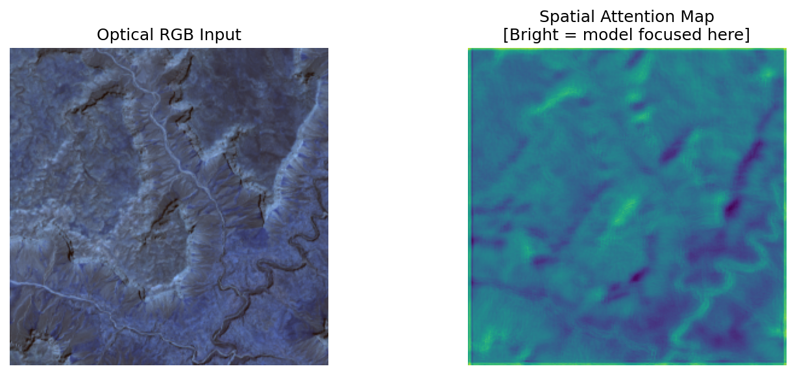
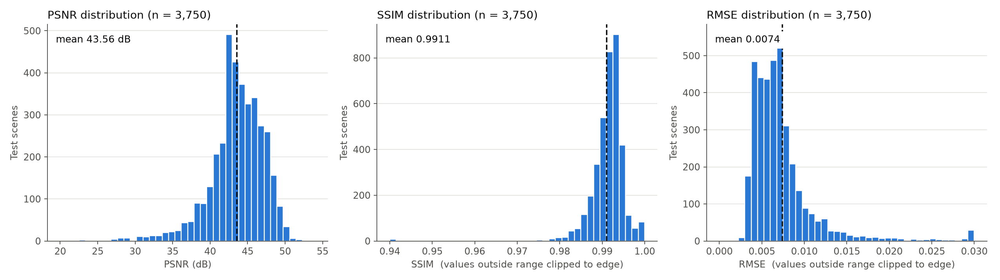
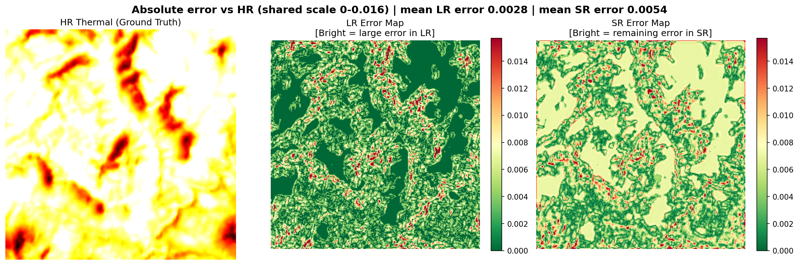

# AttentionThermalSR — Optical-Guided Thermal IR Image Super-Resolution

A lightweight, attention-based deep learning model that restores fine detail in
low-resolution **thermal infrared (TIR)** satellite images, using a co-registered
**high-resolution optical (RGB)** image of the same location as a structural guide.



| Metric (test set, n = 3,750) | Mean ± Std | Median |
|---|---|---|
| **PSNR** | 43.56 ± 3.63 dB | 43.75 dB |
| **SSIM** | 0.9911 ± 0.0094 | 0.9920 |
| **RMSE** | 0.0074 ± 0.0049 | 0.0065 |

*Final-year Major Project, Dept. of AI & ML, CMR Institute of Technology, Bengaluru (VTU).*

---

## Table of Contents
1. [Problem](#1-problem)
2. [Approach](#2-approach)
3. [Repository Structure](#3-repository-structure)
4. [Installation](#4-installation)
5. [Dataset](#5-dataset)
6. [Usage](#6-usage)
7. [Web Demo (Gradio)](#7-web-demo-gradio)
8. [Results](#8-results)
9. [Configuration Reference](#9-configuration-reference)
10. [Troubleshooting](#10-troubleshooting)
11. [Limitations & Future Work](#11-limitations--future-work)
12. [Team](#12-team)

---

## 1. Problem

Thermal cameras measure emitted heat, so they work at night, through smoke and in
fog — which makes them essential for environmental monitoring, disaster response,
agriculture and surveillance. But thermal sensors are physically limited: they
produce **blurry, low-detail images** compared with optical cameras, and
high-resolution thermal sensors are very expensive.

Optical images of the same scene contain sharp edges (rivers, roads, ridgelines,
field boundaries) that the thermal image has lost. **AttentionThermalSR learns
which of those optical structures are relevant to the thermal domain and injects
them into the thermal image**, without overwriting the thermal (temperature)
information itself.

## 2. Approach



| Stage | What it does |
|---|---|
| **Thermal encoder** | 2 × (Conv 3×3 → BatchNorm → ReLU), 1 → 32 → 64 channels |
| **Optical encoder** | Same structure, 3 → 32 → 64 channels |
| **Channel attention** | Global average pool → FC 64→8→64 → sigmoid. Learns *which* optical feature channels matter |
| **Spatial attention** | Channel-wise avg + max → 7×7 conv → sigmoid. Learns *where* in the image optical detail should be used |
| **Additive fusion** | `F_fused = F_thermal + F_optical_attended` — preserves the thermal baseline |
| **Decoder** | Conv-BN-ReLU 64→32 → Conv 32→1 → sigmoid (output in [0, 1]) |

- **Loss:** `MSE + 0.1 × gradient loss` (L1 on horizontal & vertical image gradients) — MSE for
  pixel accuracy, gradient loss for sharp edges.
- **Optimizer:** Adam (lr = 1e-3) with Cosine Annealing (T_max = 25 epochs).
- **Size:** ~58K trainable parameters, ~230 KB checkpoint — small enough for edge / on-board use.

> **Note on "super-resolution":** in this dataset the LR and HR thermal rasters have the
> same pixel grid (264 × 264). The LR image carries sensor blur and reduced radiometric
> detail, so the task is *optical-guided thermal detail restoration at fixed resolution*;
> no upsampling layer is needed.

## 3. Repository Structure

```
Optical-Guided-Thermal-IR-Image-Super-Resolution/
├── src/
│   ├── config.py          # All paths (data, checkpoint, outputs) — override via env vars
│   ├── dataset.py         # GeoTIFF loader, normalisation, 70/15/15 seeded split
│   ├── model.py           # AttentionThermalSR (encoders, CBAM, fusion, decoder)
│   ├── train.py           # Training loop (MSE + gradient loss), saves best checkpoint
│   ├── evaluate.py        # PSNR/SSIM/RMSE + LR baseline + plots + CSV
│   ├── demo_train.py      # Quick single-scene visual check
│   ├── export_samples.py  # Export test scenes as PNGs for the web demo
│   └── check_gpu.py       # Prints PyTorch / CUDA / GPU info
├── demo/
│   ├── app.py             # Gradio web interface
│   └── samples/           # Example PNG inputs (created by export_samples.py)
├── checkpoints/
│   └── best_model_1000.pth  # Trained weights
├── docs/images/           # Figures used in this README
├── outputs.zip            # Evaluation outputs (plots + metrics CSV) from the reported run
├── requirements.txt
└── README.md
```

## 4. Installation

**Requirements:** Python 3.9 – 3.12. A CUDA GPU is recommended for training; inference
and the web demo run fine on CPU.

```bash
git clone https://github.com/nilottttt/Optical-Guided-Thermal-IR-Image-Super-Resolution.git
cd Optical-Guided-Thermal-IR-Image-Super-Resolution

python -m venv venv
# Windows
venv\Scripts\activate
# Linux / macOS
source venv/bin/activate

pip install -r requirements.txt
```

For GPU training, install the CUDA build of PyTorch first (see
[pytorch.org/get-started](https://pytorch.org/get-started/locally/)), e.g.:

```bash
pip install torch --index-url https://download.pytorch.org/whl/cu121
```

Verify the environment:

```bash
cd src
python check_gpu.py     # prints torch version, CUDA version, GPU availability
python model.py         # builds the model on dummy input, prints shapes + parameter count
```

## 5. Dataset

The model is trained on a processed subset of **SSL4EO** (Landsat-8) with
**25,000 co-registered scenes**. Each scene is a folder with three GeoTIFFs:

```
ssl4eo_processed/
└── <region>/
    └── <scene>/
        ├── optical.tif      # 3 bands (RGB),  264 × 264
        ├── thermal_lr.tif   # 1 band, degraded thermal input, 264 × 264
        └── thermal_hr.tif   # 1 band, ground-truth thermal,   264 × 264
```

- Scenes missing any of the three files are skipped automatically.
- Each image is normalised to [0, 1] by its own maximum value.
- Split: **70 / 15 / 15** (train / val / test) with a fixed seed (42) — 17,500 / 3,750 / 3,750 scenes.

The dataset is too large for GitHub. Point the code at your copy with an environment
variable, or place it at `data/ssl4eo_processed/` inside the repo or `ssl4eo_processed/` next to
the repo folder (both are found automatically):

```bash
# Windows (PowerShell)
$env:THERMAL_SR_DATA = "D:\files\major_proj\ssl4eo_processed"
# Linux / macOS
export THERMAL_SR_DATA=/path/to/ssl4eo_processed
```

## 6. Usage

All scripts are run from the `src/` folder.

### Train

```bash
cd src
python train.py
```

Trains for 25 epochs on the first 1,000 scenes (700 train / 150 val), printing train/val
loss each epoch and saving the best model (lowest validation loss) to
`checkpoints/best_model_1000.pth`. Change `EPOCHS`, `BATCH_SIZE`, `LEARNING_RATE`,
`GRAD_LAMBDA` or `MAX_SAMPLES` at the top of `train.py`.

### Evaluate

```bash
python evaluate.py
```

Runs the model on the 3,750-scene test split and writes to `outputs/`:

| Folder | Content |
|---|---|
| `predictions/` | LR \| SR \| HR side-by-side with per-image PSNR/SSIM |
| `zoomed/` | 80×80 centre crops showing fine detail |
| `diff_maps/` | Absolute error maps — LR vs HR and SR vs HR |
| `attention_maps/` | Optical input + learned spatial attention map |
| `metrics/results.csv` | Per-scene SR metrics, LR-baseline metrics, and a `seen_in_training` flag |

The console summary reports the model's metrics **next to the LR-input baseline**
(how close the un-processed input already is to the ground truth) and the gain, both
for the full test set and for *strictly unseen* scenes only.

### Quick visual check

```bash
python demo_train.py    # shows LR | SR | HR for one scene
```

## 7. Web Demo (Gradio)



1. Make sure `checkpoints/best_model_1000.pth` exists.
2. (Optional) Export a few test scenes as PNG examples:
   ```bash
   cd src
   python export_samples.py 5     # writes demo/samples/scene_XX_*.png
   ```
3. Launch:
   ```bash
   cd demo
   python app.py
   ```
4. Open **http://127.0.0.1:7860** in a browser.
5. Upload a **low-resolution thermal image** (grayscale PNG/JPG) and the matching
   **optical RGB image** — or click one of the sample scenes — and press
   **Run Super-Resolution**.

The app shows the super-resolved thermal output (with a heat colormap) and an
LR | Optical | SR comparison. If the two images differ in size, the optical image is
resized to match the thermal one.

To get a temporary public link (e.g. for a remote reviewer), set
`THERMAL_SR_SHARE=1` before launching.

## 8. Results



- **87 %** of test scenes exceed 40 dB PSNR; **98.8 %** exceed 0.98 SSIM.
- The model was trained on only **700 scenes** yet evaluated on **3,750** — the results
  reflect generalisation to new geography, not memorisation.
- **Error maps** (absolute error vs. ground truth) show the remaining error is small
  everywhere and concentrated on sharp boundaries (rivers, ridgelines). `evaluate.py`
  reports the LR-input baseline alongside the model's metrics to quantify the gain:



- **Attention maps** vary across the scene and highlight structurally distinct terrain,
  showing the model selects *where* optical guidance is useful instead of copying the
  optical image wholesale.

The full set of plots and the per-scene CSV from the reported run are in `outputs.zip`.

## 9. Configuration Reference

| Environment variable | Default | Used by |
|---|---|---|
| `THERMAL_SR_DATA` | `data/ssl4eo_processed` | train, evaluate, demo_train, export_samples |
| `THERMAL_SR_CHECKPOINT` | `checkpoints/best_model_1000.pth` | train (save), evaluate, demo_train, app |
| `THERMAL_SR_OUTPUTS` | `outputs/` | evaluate |
| `THERMAL_SR_SHARE` | unset | app (`1` = public Gradio link) |

| Hyperparameter | Value |
|---|---|
| Epochs | 25 |
| Batch size | 8 |
| Learning rate | 1 × 10⁻³ (Adam) |
| Scheduler | CosineAnnealingLR, T_max = 25 |
| Gradient-loss weight (λ) | 0.1 |
| Training subset | 1,000 scenes |

## 10. Troubleshooting

| Problem | Fix |
|---|---|
| `Checkpoint not found` when starting the demo | Put `best_model_1000.pth` in `checkpoints/` or set `THERMAL_SR_CHECKPOINT` |
| `[Dataset] Total valid scenes found: 0` | `THERMAL_SR_DATA` must point at the folder that *contains* the region folders |
| `ModuleNotFoundError: rasterio` on Windows | `pip install rasterio` (wheels are available for Python 3.9 – 3.12) |
| Training is very slow | Check `python check_gpu.py` shows `True`; otherwise install the CUDA build of PyTorch |
| DataLoader hangs on Windows | Keep `num_workers=0` (the default) |

## 11. Limitations & Future Work

- Assumes the optical and thermal images are accurately co-registered; robustness to
  misalignment is not yet tested.
- Trained on a 1,000-scene subset because of compute limits — training on all 17,500
  training scenes is the natural next step.
- Evaluated only on SSL4EO / Landsat-8; testing on UAV and other thermal sensors is future work.
- A same-dataset comparison with published guided-SR models (e.g. LapGSR, PAG-SR) is planned.
- True ×2 / ×4 upscaling (different LR grid) would need an upsampling stage in the decoder.

## 12. Team

| Name | Role |
|---|---|
| Nilotpal Arya | Student, Dept. of AI & ML, CMRIT |
| Abdulrehan M K | Student, Dept. of AI & ML, CMRIT |
| Naman Jain | Student, Dept. of AI & ML, CMRIT |
| Purvi Ashok Kalliganur | Student, Dept. of AI & ML, CMRIT |
| **Ms. Divyamani L.** | Project Guide, Assistant Professor, Dept. of AI & ML, CMRIT |

**Research paper:** *AttentionThermalSR: An Optical-Guided Attention-Based Multimodal
Framework for Thermal Infrared Image Super-Resolution* (submitted).
